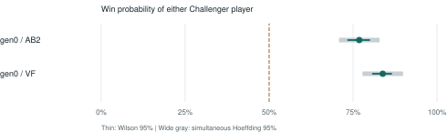

# Catan Challenger Research

A reproducible evaluation of a human-informed Catan policy with learned opening rankings, using Catanatron as the external rules engine.

**Status:** technical report and research artifact; not peer-reviewed. The confirmation protocol is fixed before execution. Read the final report for results and uncertainty. This is an individual four-player game: two Challenger bots and two external bots each pursue their own win; they do not form teams.

[English report (PDF)](output/pdf/catan-challenger-report.en.pdf) · [日本語レポート (PDF)](output/pdf/catan-challenger-report.ja.pdf) · [Download the research release](https://github.com/midori11111111/catan-challenger-research/releases/tag/v0.1.0)

[日本語](README.ja.md) · [Play the published website](https://catan-challenger-online.vercel.app/)

<!-- CONFIRMATION-RESULTS-START -->
## Confirmation results

| Model | Public-information opponent | Wins / games | Win rate | Wilson 95% |
|---|---|---:|---:|---:|
| gen0 | AlphaBeta depth 2 (unpruned) | 461/600 | 76.8% | 73.3-80.0% |
| gen0 | ValueFunction | 503/600 | 83.8% | 80.7-86.6% |

All 1,200 games completed with zero invalid games; all six seat pairs have 100 observations per group. 2/2 groups meet the simultaneous Hoeffding superiority criterion against the 50% neutral reference. These are corrected-bridge, fixed-budget results; pilots are not pooled.



<!-- CONFIRMATION-RESULTS-END -->

## What is being evaluated?

The executable policy combines hand-designed strategic evaluation, resource exchanges, road/settlement/city and development-card decisions, robber placement, and a search for available guaranteed winning action sequences. A small neural model reranks selected opening placements. These experiments do not call an LLM during play and do not train or update the evaluated policy.

| Configuration | Opening model | Rank mixture | Main-game policy |
|---|---|---:|---|
| gen0 | trained generation 0 | 0.5 | shared published policy |
| gen1 | trained generation 1 | 1.0 | shared published policy |
| gen2 | trained generation 2 | 0.5 | shared published policy |

All three configurations already contain learned opening components. A mixture of 0.5 is a weighted combination of model and base **ranks**, not a 50% chance of invoking the model. The learned selector covers the first settlement for every seat and a conditional second-settlement selector for seat 1. Other second placements use the pair-placement baseline. Its scores are ranking signals, not calibrated action win probabilities.

Even a mixture of 1.0 retains the base candidate pool, stored override margins and the shared main-game policy. It does not make the whole agent a purely learned policy.

## Reproduce the evaluation

Requires Python 3.12 and Node.js 20 or later. The measured environment uses Python 3.12 and Node.js 24; dependency versions and source hashes are saved in the protocol.

The transport targets macOS/Linux. Native Windows pipe handling is not supported by this runner; use a Linux environment such as WSL for these commands.

```sh
python3.12 -m venv .venv
.venv/bin/python -m pip install -r requirements.txt
.venv/bin/python verify_public.py
.venv/bin/python verify_belief.py
.venv/bin/python audit_runtime.py
PYTHONHASHSEED=0 .venv/bin/python confirmation.py prepare --out data/new-confirmation
PYTHONHASHSEED=0 .venv/bin/python confirmation.py run --out data/new-confirmation --workers 12
```

The dependency pins [Catanatron](https://github.com/bcollazo/catanatron) to commit `ecf931181b9a65bb4116a2153fb78c16f1438e00`. Published inference weights are included; full training datasets and a full historical training reproduction are outside this artifact's scope.

Evaluation numbers embedded in the model's metadata describe earlier internal tests. They are neither this report's external confirmation rates nor calibrated probabilities for individual moves.

The corrected confirmation fixes the pre-existing public default gen0 and has 600 games for each of two opponents, for 1,200 games total. gen1/gen2 remain bundled but are not part of this confirmation. Each of the six possible Challenger seat pairs appears 100 times per combination. Opponents are stock base ValueFunction and depth-2, **unpruned** base AlphaBeta, each wrapped to use public-information beliefs. Each game uses a separate seed. Source hashes must match to resume, and results never trigger an automatic production update.

`AB_FULL` in data files means the full, unpruned action set; it does **not** mean full information. Running this published protocol into a new directory reproduces the published seed schedule. A new independent confirmation requires a new versioned seed schedule; do not pool repeated runs of the same seeds as extra independent games.

```sh
.venv/bin/python confirmation.py status --out data/new-confirmation
.venv/bin/python confirmation.py stop --out data/new-confirmation
PYTHONHASHSEED=0 .venv/bin/python confirmation.py resume --out data/new-confirmation --workers 12
```

Stopping waits for in-flight games to be recorded. Sleep suspends computation; after waking the existing process can continue. A process interrupted by OS restart may leave a `RUNNING` lock; check the recorded PID before removing a stale lock. An invalid game halts new submissions and is not silently replaced.

## Statistical interpretation

The primary metric is the probability that either Challenger bot wins. The neutral reference is **50%**, not 25%. Each group reports a Wilson 95% interval. The predeclared superiority rule uses a simultaneous Hoeffding 95% lower bound above 50% across both groups; at 600 games the bound extends approximately 6.04 percentage points on either side. This conservative rule allows fixed seat strata to have different win probabilities. Wilson intervals are descriptive and are not treated as a joint family-wide guarantee.

The sample size targets useful precision (worst-case Wilson half-width about four percentage points). It cannot guarantee significance for an arbitrarily small advantage or establish an ordering among generations.

## Adapter audit and scope

The earlier v4 confirmation attempt is **withdrawn in full**. It stopped at a transport timeout, and replay auditing found that hidden-VP sampling could create an impossible already-won root in an ongoing game, prematurely stopping AlphaBeta. v5 conditions both players' reconstructed states on nonterminal VP bounds. `verify_belief.py` reproduces the old counterexample and verifies the correction. No v4 rate is pooled with the final 1,200 games; see `HISTORY.md`.

Both sides receive only their own exact private hand and estimates derived from public totals, card counts, and board information. Actual opponent private hands, actual hidden development-deck composition, and future engine RNG are withheld. Challenger uses a production-weighted resource estimate; native opponents receive a sampled feasible allocation. These are information-restricted wrappers, not unchanged omniscient native players.

The engine owns legal actions and game outcomes. The Challenger bridge invokes the published policy anew after every external atomic action, so its complete turn sequence need not match a turn executed inside the website. It adjusts Road Building resolution order and filters Road Building use when no road can legally be placed.

The earlier pilot's setup conversion counted both directed representations of one road. This corrupted setup step/seat features. The public artifact de-duplicates physical roads and validates all eight setup steps. Earlier pilot results are retained as **superseded exploratory observations**, not pooled with confirmation results or presented as verified performance of the corrected bridge.

The evaluated action space includes bank/port trades, but no player-to-player negotiation. Catanatron's base evaluator considers only one opponent's production; results against these two baselines do not establish superiority over the full field of Catan AIs or human experts. No direct comparison with HexMachina has been performed.

The two baselines share that evaluator. A further terminal-state audit found some differences between exact edge-simple trail lengths and Catanatron's cached road lengths. Native scoring is authoritative for every recorded outcome; the artifact does not assert exact equivalence to every detail of standard CATAN. See `verification-semantics.json` and `audit_semantics.js`. All observations stay in the predeclared analysis. Seed/hash controls support reproducible conditions; time-limited search and machine differences can still affect trajectories. Archived outcomes define the reported dataset.

## Artifact map

- `frozen/`: published policy snapshot and trained opening models, checked by SHA-256.
- `confirmation.py`: fixed-size, resumable confirmation and statistics.
- `run.py`, `run_2v2.py`: game bridge, public-information projection, game execution.
- `conversion.js`, `driver.js`, `bot.js`, `runtime.js`: native/JavaScript interface.
- `verify_public.py`, `fixtures/`: information/geometry/setup/road regression checks.
- `data/confirmation/`: protocol, all per-game results, summaries, and final game records.
- `data/pilot-*`: superseded pilot results and compressed simulated-game records.
- `output/pdf/`: English and Japanese reports.
- `paper/`: report builder and publication figures.

The primary replay data are synthetic AI games and contain no uploaded human game records. `MANIFEST.sha256` in the publication archive records the distributed files. Cite with `CITATION.cff`. Code is distributed under GPL-3.0-or-later; see `LICENSE` and `NOTICE.md` for attribution.
