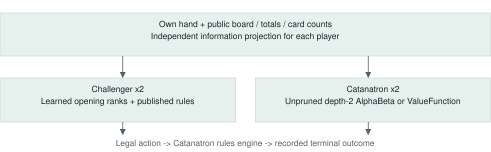
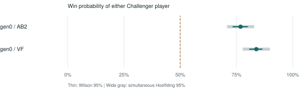

# Catan Challenger: Evaluating a Heuristic Policy with Learned Opening Rankings against Catanatron

midori11111111 - Technical report v0.1.0 | October 31, 2026 | Not peer-reviewed

## Abstract

We present a reproducible engineering evaluation of Catan Challenger, a published policy combining human-informed main-game decisions with learned opening rankings. The frozen, pre-existing public default (gen0) is evaluated in four-player games containing two Challenger agents and two external agents. A fixed-budget confirmation specifies 600 independent games per opponent, totaling 1,200 games, with all six seat-pair assignments balanced. Opponents are base ValueFunction and unpruned depth-2 AlphaBeta, under explicit public-information wrappers. The corrected bridge has completed 1,200 games (completed). Observed group win rates range from 76.8% to 83.8%; 2/2 groups meet the predeclared simultaneous superiority criterion. We release inference code, trained weights, a versioned adapter, protocol, and synthetic game records. Claims concern these opponents and conditions; no claim of world-best or expert-human strength is made.

## 1. Motivation and contribution

Catan combines stochastic production, hidden cards, growth investments, and contested awards. A useful evaluation must distinguish policy strength from seat advantage, information access, and interface errors. Our contribution is an inspectable external evaluation artifact, rather than a new proof of optimal play.

## Executable policy, offline learning

The production policy executes ordinary code. Its neural component ranks selected opening settlements; its main-game actions use strategic evaluation and tactical planning. No language-model API is invoked during a game. AI coding assistance was used in development and drafting.

## Evaluation boundary

We evaluate the already-trained public default without modifying its weights on confirmation games. Other generations are bundled for inspection, not ranked here. The inference and evaluation are reproducible from the artifact. Reproducing the complete historical training process is outside the release scope.

Figure 1. Each agent receives its own observation. The external engine executes legal actions and records terminal outcomes.

## 2. Policy and opening model

All three configurations use the same published main-game settings. gen0 already contains generation-0 learned weights with rank mixture 0.5; gen1 uses generation-1 weights with mixture 1.0; gen2 uses generation-2 weights with mixture 0.5. These are different models and mixtures, not a clean learned-versus-unlearned ablation.

## Opening score

The action network takes 77 standardized features, applies one 20-unit tanh hidden layer, then a sigmoid output. A separate completed-opening network takes 75 features and has the same hidden width. Inputs describe resource/number production, concentration, ports, scarcity, opponent-relative portfolios, and candidate/base rank. The completed-opening features include expansion access and initial resources.

## Prediction and rank mixing

For features f, z = clip((f - mu) / sd, -8, 8); h = tanh(W1 z + b1); q = sigmoid(clip(W2 h + b2, -30, 30)). Candidates are sorted by q. Selection minimizes (1 - lambda) r_base / (K - 1) + lambda r_model / (K - 1), subject to the stored override margin. q is a ranking signal, not a calibrated probability that an individual action wins.

## Where the model is used

For each seat, the first-settlement selector reranks up to 12 base candidates. A completed-opening selector applies to seat 1 at its final second settlement, using a larger candidate set. Other second settlements use the existing pair-placement baseline. A 50% mixture means equal weight on normalized ranks, not randomized activation on half of turns.

## Main-game decisions

The policy evaluates cities, settlements, roads, development cards, exchanges, and waiting. It includes production-aware resource use, route/port goals, contested-award reasoning, robber selection, and hand compression. It repeatedly searches for a winning sequence within its reconstructed state, including exchanges, builds, cards and awards. Foreign-engine or belief differences can invalidate the forecast. The optional rollout-only invincible setting is not evaluated here.

## Limits of mechanism claims

This evaluation can establish external performance of frozen configurations. It does not by itself show that learned placement caused the measured advantage, that every opening is handled well, or that the neural score is calibrated. A matched no-learning ablation and direct human evaluation remain separate experiments.

## 3. Fixed confirmation protocol

We predeclare two groups: public-default gen0 against each of two opponents. Each group has 600 games; Challenger occupies each of the six possible two-seat subsets 100 times. Each game uses a new seed. Seed selection inspects only the seating draw, never the board, dice, or outcome. Each player seeks its own ten points; the two Challenger instances do not share hands or coordinate as a team.

## External opponents and information

Catanatron commit ecf931181b9a65bb4116a2153fb78c16f1438e00 owns rules, actions and outcomes. We use its base map, official_spiral number placement, ten-point target, discard limit 7 and friendly_robber=False. AlphaBeta uses depth 2, base evaluation, prunning=False and the upstream 20-second search deadline. ValueFunction uses its base evaluator. Both receive sampled states consistent with public totals and their own private hand, conditioned on no player already having ten points in an ongoing game. Challenger uses a production-weighted estimate. Real opponent hands, real hidden deck composition and future RNG are withheld. This is not an unmodified omniscient native-player benchmark.

## Precision and decision rule

The primary outcome is whether either Challenger wins, with neutral reference 0.5. Descriptive Wilson 95% intervals at n=600 have worst-case half-width about 4 percentage points [3]. The primary superiority rule uses Hoeffding plus a union bound across both groups [4]: epsilon = sqrt(log(2 x 2 / 0.05) / (2 x 600)) = 0.06043. A group confirms superiority only if p_hat - epsilon > 0.5 after all 600 valid games. This conservative bound allows different win probabilities in fixed seat strata, assuming independent randomized games.

## Stopping and invalid games

There is no favorable-interim stopping. Each result is checkpointed and resume requires identical policy/adapter hashes. Any adapter error or unfinished game halts new submissions; invalid observations are not selectively replaced. Bank and port trades are available; player-to-player trade negotiation is outside this evaluated action space.

## Interface audit and withdrawn runs

Pilots double-counted directed roads; v4 then allowed sampled hidden VP to create a false ten-point opponent, prematurely ending AlphaBeta search. All v4 observations (2,714 completed plus one transport timeout) are withdrawn. v5 conditions hidden-card samples on nontermination and checks all eight opening steps. It also adapts mandatory Road Building resolution. The default was chosen by prior deployment, not old results. New seeds and source hashes define this confirmation.

## 4. Confirmation results

All 1,200 fixed-budget games completed. 2 of two groups satisfy the simultaneous lower-bound criterion.

| Model | Opponent | Wins / n | Win rate | Wilson 95% | Joint lower |
|---|---|---|---|---|---|
| gen0 | AB2 | 461/600 | 76.8% | 73.3-80.0% | 70.8% |
| gen0 | VF | 503/600 | 83.8% | 80.7-86.6% | 77.8% |

Figure 2. Two groups with public-information baseline wrappers. Dashed: 50% neutral reference. Wide intervals control all groups jointly.

AB2 denotes unpruned depth-2 AlphaBeta. Win rate counts either Challenger player; it is not the individual win rate of each bot. Wilson intervals describe each group separately; the family-wide Hoeffding intervals support the predeclared superiority decision. Groups are not pooled to manufacture a single-model win rate.

These measurements support only the group-specific conclusions shown in the table. Only the pre-existing public default is confirmed here. These results do not establish a generation ranking or monotonic improvement. All source hashes, legal outcomes and seat counts must pass the artifact audit before release.

All 1,200 games completed; mean 75.1 dice rolls per game. Road-rule interface adaptations: 237/181,276 Challenger decisions. Outcome, seat and hash audit: passed.

Native-rule anomalies retained without exclusion: 0 terminal games with multiple players at ten points; 1 games with a road-award flag below five cached road edges. See validation.json for IDs.

Supplementary post hoc terminal audit: 333/4,800 player views differed in native cached versus exact trail length. Piece counts and reconstructed public scores matched. No observations were excluded.

Validity checks before confirmation: 512 native hidden-card samples and 64 Challenger reconstructions produced no phantom terminal root. VP allocations are weighted by combinatorial slot counts subject to public-score caps. The transport guard is 120 active-wait seconds and ignores OS-suspension gaps; the native AlphaBeta search deadline remains 20 wall-clock seconds. These are bridge fixes, with policy weights unchanged.

## 5. Discussion and limitations

The central distinction is between making a predictor score well and demonstrating a policy improvement on held-out games. The present study measures frozen policies against external opponents. It does not establish a general method that reliably improves Catan through unlimited self-play, and does not validate a new main-game reinforcement learner.

## Baseline and rule scope

Both opponents share the base evaluator, which considers one opponent's production rather than all three. Coverage is therefore narrow. Stronger search, alternative evaluators, other engines, negotiation and expert humans may expose different weaknesses. Beliefs are approximate, and the bridge re-evaluates after every atomic action. An additional terminal-state audit found some exact edge-trail lengths disagree with Catanatron's cached road lengths. Native scoring remains authoritative for all outcomes; the observed games are not asserted equivalent to every detail of standard CATAN.

## Related work

Catanatron supplies the engine and native baselines [1]. HexMachina studies LLM-guided evolution of executable Catan players [2]. Our artifact studies a different human-informed, learned-opening policy and a four-player evaluation protocol. No head-to-head result against HexMachina is reported, and its published percentages should not be compared directly with this two-of-four outcome.

## Reproducibility and next experiments

The release includes frozen JavaScript sources and opening weights, pinned Catanatron dependency, public-information projection, setup/geometry/hidden-information checks, source hashes, fixed protocol, per-game outcomes and compressed full game records. Follow README.md to verify and rerun into a new directory. Next steps include a matched no-learning opening ablation, stronger and more diverse opponents, and a separately consented expert-human study. Read CITATION.cff and NOTICE.md for attribution and scope.

## References

[1] B. Collazo and contributors. Catanatron 3.3.0. Commit ecf931181b9a65bb4116a2153fb78c16f1438e00. https://github.com/bcollazo/catanatron
[2] N. Belle et al. Agents of Change: Self-Evolving LLM Agents for Strategic Planning. arXiv:2506.04651v2, 2025. https://arxiv.org/abs/2506.04651v2
[3] E. B. Wilson. Probable Inference, the Law of Succession, and Statistical Inference. JASA 22(158), 209-212, 1927. https://doi.org/10.1080/01621459.1927.10502953
[4] W. Hoeffding. Probability Inequalities for Sums of Bounded Random Variables. JASA 58(301), 13-30, 1963. https://doi.org/10.1080/01621459.1963.10500830
