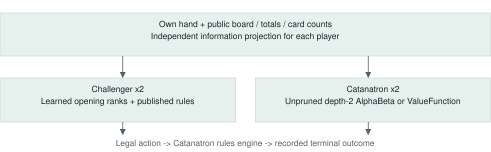
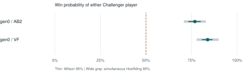

# 学習済み初期配置ランキングを備えた カタン挑戦者AIの再現可能な外部評価

midori11111111 - 技術レポート v0.1.0 | 2026年10月31日 | 査読前

## 要旨

本稿は、人間の戦略知識を取り入れた本編方策と学習済み初期配置ランキングを組み合わせたカタン挑戦者AIの外部評価を報告する。従来からの公開標準設定gen0を凍結し、こちら2体・外部AI2体の独立した4人戦で評価する。相手は候補を絞らない深さ2のAlphaBetaとValueFunctionであり、双方に公開情報から推定した状態を渡す。相手ごとに600試合、合計1,200試合と判定方法を開始前に固定し、席の全6組を均等にした。現在の完了数は1,200試合である。2構成中2構成が、同時信頼区間を使う事前の優位判定を満たした。コード、重み、接続の検証、評価条件、AI同士の棋譜を提供する。結論は今回の相手・ルール・情報条件に限り、世界最強や人間の上級者への優位を主張しない。

## 1. 目的と貢献

カタンでは、出目による生産、非公開カード、増産への投資、他者との賞の競合が同時に起きる。強さの比較には、方策の質と、席・情報量・外部接続の誤りを区別する必要がある。本稿の貢献は、評価条件と判断処理を確認できる外部評価の実装・測定資料である。

## 対局時に動く仕組み

対局中の判断は通常のプログラムで実行する。ニューラルモデルは指定された初期配置候補の順位付けを担当し、本編は戦略評価と戦術的な手順探索を使う。対局の手を決めるためのLLM API呼び出しはない。開発・コード確認・レポート作成にはAIコーディング支援を用いた。

## 再現する範囲

確認試合の結果を使ってモデルや係数を更新せず、既存の公開標準gen0を固定して測る。他世代もコードに含めるが、今回の確認対象にはしない。含めた重みでの判断と外部評価を再現できる一方、全学習データと歴史的な学習工程一式の再現は本公開物の対象外である。

図1. 各個体が独立した観測から判断し、外部エンジンが合法手を実行して終局を記録する。

## 2. 判断方策と配置モデル

本編の設定は3構成で共通である。gen0も既に第0世代の学習重みを混合率0.5で使う。gen1は第1世代の重みを1.0、gen2は第2世代の重みを0.5で使う。モデルと混合率が異なるため、学習あり・なしだけの要素比較ではない。

## 配置スコアの計算

1軒目のネットワークは77特徴を標準化し、20ユニットのtanh隠れ層を経てsigmoid値を出す。配置完成形用の別モデルは75特徴・同じ隠れ層幅を持つ。特徴には資源・数字の生産、偏り、港、島の希少性、相手との差、候補の既存順位等がある。完成形には拡張先への距離や初期資源も含む。

## モデル値と順位の混合

z = clip((f - mu) / sd, -8, 8)、h = tanh(W1 z + b1)、q = sigmoid(clip(W2 h + b2, -30, 30)) とする。qで候補を並べ、(1 - lambda) r_base / (K - 1) + lambda r_model / (K - 1) が小さい候補を、保存された上書きマージンも使って選ぶ。qは順位付けの信号であり、その手の正確に較正された勝率ではない。

## 学習モデルが使われる場所

全席の1軒目では、既存評価の上位12候補までを再順位付けする。1番手の最後の2軒目では、より広い候補集合を完成形モデルで評価する。他の席の2軒目は既存のペア配置ロジックを使う。混合率50%は、半数のターンだけモデルを使う意味ではない。

## 本編の行動

都市・開拓地・道路・カード・交換・ステイを評価する。資源の用途と生産力、道路・港の目的地、他者との賞レース、盗賊、手札圧縮等を扱う。再構成した状態で、交換・建設・カード・賞を組み合わせて今10点に到達する手順を繰り返し探す。外部エンジンの解釈や手札推定が異なる場合、見込んだ勝利が成立しないこともある。追加ロールアウトを使う無敵AI設定は評価しない。

## 仕組みから言えることの限界

凍結した構成の外部成績を測れる一方、この実験だけでは優位の原因を学習配置に限定できない。学習なしを対照にした同条件の比較や、人間上級者との評価は別途必要である。

## 3. 確認実験の事前固定

公開標準gen0と2種類の相手を各600試合、合計1,200試合とする。こちらが担当する席の6組を各100回ずつ使う。試合ごとに新しいseedを使い、席の抽選だけを確認して割り当てる。盤面・出目・勝敗では選別しない。各個体が自分の10点を目指し、こちらの2体も手札共有や協力をしない。

## 相手と情報条件

Catanatronのコミットecf931181b9a65bb4116a2153fb78c16f1438e00がルール・合法手・勝敗を管理する。基本マップ、official_spiralの数字配置、10点目標、捨て札上限7、friendly_robber=Falseを使う。AlphaBetaは深さ2、base評価、prunning=False、探索上限20秒。ValueFunctionはbase評価である。双方が公開総数・自分の手札・未終局に整合する推定状態を使い、相手の実手札・実山札・未来の乱数は利用しない。こちらは生産力に基づく推定を使う。内部情報へアクセスできる未加工ボットとの比較ではない。

## 精度と判定式

主要指標は、こちらのどちらかが勝った割合で、互角の基準は0.5とする。600試合のWilson95%区間の最大半幅は約4ポイントである[3]。主要な優位判定には、Hoeffding不等式と2構成へのunion boundを使う[4]。epsilon = sqrt(log(2 x 2 / 0.05) / (2 x 600)) = 0.06043 とし、全600試合完了後に p_hat - epsilon > 0.5 の構成だけを優位確認とする。独立した試合を仮定し、席によって勝率が異なる場合も扱える保守的な方法である。

## 停止と無効試合

途中の都合の良い勝率による打ち切りはしない。各結果を保存し、再開時にはソースのhash一致を確認する。接続エラーや未完走が出た場合は新規投入を停止し、失敗局だけを置き換えない。銀行・港の交換は使えるが、対人間のようなプレイヤー間交渉は評価対象外である。

## 接続の監査と旧結果の撤回

予備実験の道路二重計数に加え、v4では伏せVP推定により未終局なのに相手10点の状態を作り、AlphaBeta探索が早期終了していた。v4の2,714完走と1件の応答待ち失敗は全て撤回する。v5は未終局に条件付けたカード推定と配置8手を検証し、街道建設も外部仕様へ合わせた。旧成績から選ばず、従来の公開標準を新seedで確認する。

## 4. 確認実験の結果

事前固定した全1,200試合が完了した。2構成中2構成が、同時区間の下限による優位判定を満たした。

| モデル | 相手 | 勝利 / n | 勝率 | Wilson 95% | 同時下限 |
|---|---|---|---|---|---|
| gen0 | AB2 | 461/600 | 76.8% | 73.3-80.0% | 70.8% |
| gen0 | VF | 503/600 | 83.8% | 80.7-86.6% | 77.8% |

図2. 事前固定した2構成。破線は互角の50%。太い灰色の区間は2構成を同時に扱う保守的な区間。

AB2は候補を絞らない深さ2のAlphaBeta。勝率は「こちら2体のどちらかが勝つ割合」であり、各個体の勝率ではない。Wilson区間は各構成の記述用、同時Hoeffding区間は2構成全体の優位判定用である。異なる構成の結果を混ぜて単一モデルの勝率とはしない。

結論は表の構成ごとに解釈する。確認対象は以前からの公開標準設定であり、世代の順位や単調な成長を示す表ではない。公開前に、ソースhash、全勝者、席の件数が保存物と一致することを確認する。

全1,200試合が完走し、平均ダイス数は75.1回。道路ルールへの接続上の適応は、こちらの181,276判断中237回。勝者・席・hashの検証結果は配布物のvalidation.jsonに保存する。

外部ルール上の例外として、終局時に複数人が10点以上の試合0件、内部道路長5本未満で道賞フラグがある試合1件を含む。除外せず、IDをvalidation.jsonに保存した。

追加の事後的な終局監査では、4,800人分の状態のうち333件で内部道路長と一筆書き長が異なった。駒数と公開得点の再構成は一致し、この差を理由に試合を除外していない。

開始前検査では、512通りの相手側カード推定と64通りのこちら側の再構成で、架空の終局が出ないことを確認した。伏せVPは公開得点の上限を守り、組合せ数で重み付けして割り当てる。通信待ちはOS休止を除く120秒、相手AlphaBetaの探索上限は従来の実時間20秒である。モデル重みは変更していない。

## 5. 考察と限界

予測器の指標が良くなることと、未知の対局で方策が強くなることは区別する必要がある。本稿は凍結した方策の外部評価を行う。自己対戦を無限に追加すれば必ず成長する方法を確立したものではなく、新しい本編の強化学習器の有効性を示すものでもない。

## 相手とルールの範囲

相手2種類は同じbase評価器を共有し、3人全員でなく1人分の相手生産力を考慮するため、比較の広がりは限られる。深い探索、別評価器・エンジン、交渉、人間上級者では別の弱点が現れ得る。手札推定は近似で、外部の1行動ごとに判断し直す点もサイトと異なる。追加の終局監査では、一部の正確な一筆書き長とCatanatronの内部道路長にも差が見つかった。勝敗は全試合で外部エンジンに従い、通常のCATANの全細部との等価性までは主張しない。

## 関連研究

Catanatronを外部エンジン・相手方策として使う[1]。HexMachinaはLLMによる実行可能なカタン方策の進化を扱う[2]。本公開物は、人間の知識と学習済み初期配置を組み合わせた別の方策を4人戦で評価する。HexMachinaとの直接対戦は未実施であり、論文中の勝率と本稿の2体分合計勝率を直接比較しない。

## 再現性と次の実験

凍結ソース・配置重み、上流コミットの指定、公開情報への変換、配置・座標・情報漏れの検証、hash、固定した条件、試合別結果、圧縮した完全棋譜を提供する。READMEの手順で検証し、新しい出力先へ再実行できる。次は配置学習なしを対照にした比較、相手の多様化、同意を得た人間上級者との実験が必要になる。著者・ライセンス・支援の記載はCITATION.cffとNOTICE.mdにまとめる。

## References

[1] B. Collazo and contributors. Catanatron 3.3.0. Commit ecf931181b9a65bb4116a2153fb78c16f1438e00. https://github.com/bcollazo/catanatron
[2] N. Belle et al. Agents of Change: Self-Evolving LLM Agents for Strategic Planning. arXiv:2506.04651v2, 2025. https://arxiv.org/abs/2506.04651v2
[3] E. B. Wilson. Probable Inference, the Law of Succession, and Statistical Inference. JASA 22(158), 209-212, 1927. https://doi.org/10.1080/01621459.1927.10502953
[4] W. Hoeffding. Probability Inequalities for Sums of Bounded Random Variables. JASA 58(301), 13-30, 1963. https://doi.org/10.1080/01621459.1963.10500830
